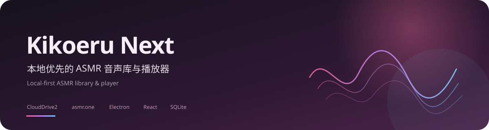
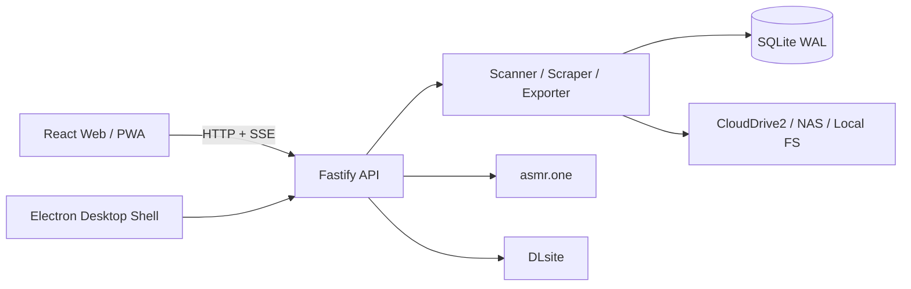

<div align="center">
  
</div>

<p align="center">
  
</p>

<p align="center">
  <a href="https://github.com/r1907200753/kikoeru-next/releases"></a>
  
  
  
  
  
  
</p>

<h1 align="center">Kikoeru Next</h1>

<p align="center">
  <strong>本地优先的 ASMR 音声库与播放器</strong><br />
  Local-first ASMR library &amp; player for Windows
</p>

---

## 简介

Kikoeru Next 是一个本地优先的 ASMR 音声库与播放器：把你的音声作品放在 CloudDrive2、NAS 或本地磁盘上，由它负责扫描、刮削、封面、播放、进度与导出；需要在线时，再连接你自己的 asmr.one 账号。

它不绑定云盘厂商，不移动你的文件，也不依赖第三方服务器保存你的曲库索引。数据默认留在本机，桌面端提供 Electron 便携包，手机可以在电脑唤醒时通过局域网访问标准版网页。

## 主要功能

| 模块 | 能力 |
| --- | --- |
| 本地库 | 多库根、RJ号识别、目录树/差分目录、DLsite 刮削、封面缓存、中文标签、搜索与筛选、播放进度、收藏、最近收听 |
| 在线库 | asmr.one 搜索与分页、作品详情、在线试听、语言版本切换、我的收藏 / 进度 / 歌单、在线音频格式偏好 |
| 文件浏览 | 详情页文件树与面包屑浏览，音频、视频、图片、字幕分类查看；在线作品同样提供文件树与列表切换 |
| 导出到本地 | 完整在线文件树选择（文件夹三态、类型概览、总大小）、导出队列、暂停 / 继续 / 取消 / 删除、Range 断点续传、失败重试、并发控制、自动扫描入库、重复 RJ号跳过 |
| 播放器 | 在线 / 本地统一全局播放器、迷你播放器、全屏播放器、文件夹播放列表、跨目录字幕匹配、桌面歌词 Document PiP、声道交换、睡眠定时；在线曲目同样支持字幕与桌面歌词 |
| 桌面与移动 | Electron 便携 zip、托盘、单实例、端口冲突回退、局域网登录、PWA / 主屏图标、WOL 说明 |

## 界面与体验

- 本地 / 在线 / 全部三种浏览范围；在线结果按 RJ号标记“已有本地”。
- 推荐、标签、社团、声优、收藏、最近收听与播放列表统一入口。
- 详情页采用文件浏览器布局，文件卡片铺满整行；操作键保持低密度图标化。
- 本地与在线偏好分离：首页密度、智能路径、效果音、音频类型分别保存。
- 多套色系主题，背景、卡片、描边与播放器表面一起变化。

## 更新日志

完整版本记录见 [CHANGELOG.md](./CHANGELOG.md)；最新安装包在 [Releases](https://github.com/r1907200753/kikoeru-next/releases)。

## 架构



- 桌面端主进程内嵌 Fastify，窗口加载同源 `http://127.0.0.1:<port>`。
- 服务端统一处理扫描、刮削、导出、流媒体 Range、鉴权与操作日志。
- 在线请求只经本机后端代理，asmr.one token 不下发浏览器。
- 数据库使用 SQLite WAL；封面按内容寻址缓存，音频不做全量哈希。

## 技术栈

- TypeScript 全栈，npm workspaces
- 后端：Fastify 5 + `node:sqlite`（WAL）
- 前端：React 19 + Vite，hash 路由
- 桌面：Electron 45，便携 zip，无安装器
- 外部：DLsite、asmr.one、FFprobe / FFmpeg

## 快速开始

要求 Node.js ≥ 22、npm，以及可用的 FFprobe（读取时长）与 FFmpeg（处理封面）。Windows 10/11 为主要目标平台。

```bash
npm install
npm run dev:server   # http://127.0.0.1:31777
npm run dev:web      # http://localhost:5173，/api 代理到后端
```

首次启动后，在设置页添加一个或多个本地库目录，按需配置代理与 FFprobe / FFmpeg 路径。

### 桌面打包

```bash
npm run pack:desktop
```

输出在 `release/`：Electron 便携 zip 与解压版，解压即用，无需安装器。

### 校验

```bash
npm run typecheck
npm test
npm run build:web
```

## 配置

| 环境变量 | 说明 | 默认值 |
| --- | --- | --- |
| `KIKOERU_DATA_DIR` | 数据目录（数据库、封面缓存） | `data` |
| `KIKOERU_DB_PATH` | 数据库文件路径 | `<DATA_DIR>/kikoeru.sqlite` |
| `KIKOERU_LIBRARY_PATH` | 本地库根，覆盖设置中的库根 | 空 |
| `KIKOERU_PROXY_URL` | 下载 / 刮削代理 | 空 |
| `KIKOERU_FFPROBE_PATH` | FFprobe 可执行路径 | `ffprobe` |
| `KIKOERU_HOST` | 监听地址 | `127.0.0.1` |
| `KIKOERU_PORT` | 监听端口 | `31777` |

> npm workspace 脚本的工作目录是 `apps/server`；`KIKOERU_DATA_DIR`、`KIKOERU_DB_PATH`、`KIKOERU_LIBRARY_PATH` 请使用绝对路径，避免相对路径解析到 `apps/server`。

## 项目结构

```text
apps/server        Fastify API、导出队列、静态资源
apps/web           React 前端（主页 / 搜索 / 收藏 / 最近 / 导出 / 在线）
apps/desktop       Electron 便携壳（内嵌服务 / 托盘 / 单实例 / PWA）
packages/core      扫描、刮削、数据库、设置、多库根、变体标签、导出器
packages/shared    共享类型与标签映射
tools/probe        外部链路探针
fixtures           解析器与回归测试样本
```

## 安全与合规

- 仅使用你自己的 asmr.one 账号与官方接口，不绕过付费与 DRM；请只导出你有权保存的内容。
- 账号 token 加密保存，不下发浏览器，不写入操作日志。
- 默认只绑定 `127.0.0.1`；开启局域网访问时强制登录。
- 文件访问经过库根校验，阻止路径穿越。
- 本仓库不包含用户曲库、账号、测试数据或工程文档。

## 许可

MIT。详见 [LICENSE](./LICENSE)。

---

<p align="center">
  <sub>Built for a local-first, personal listening workflow.</sub>
</p>
